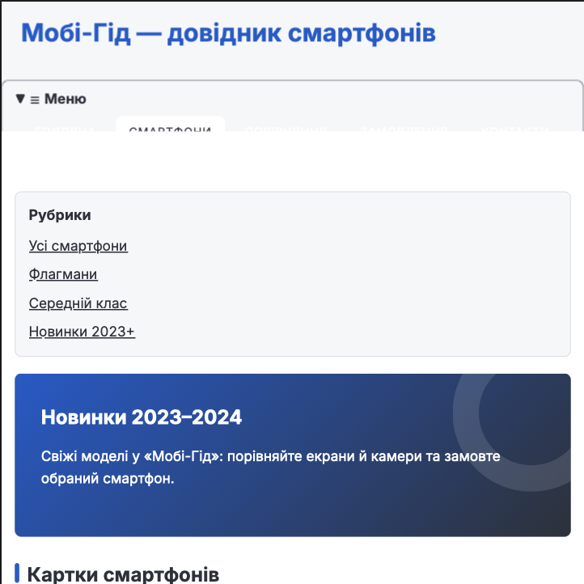
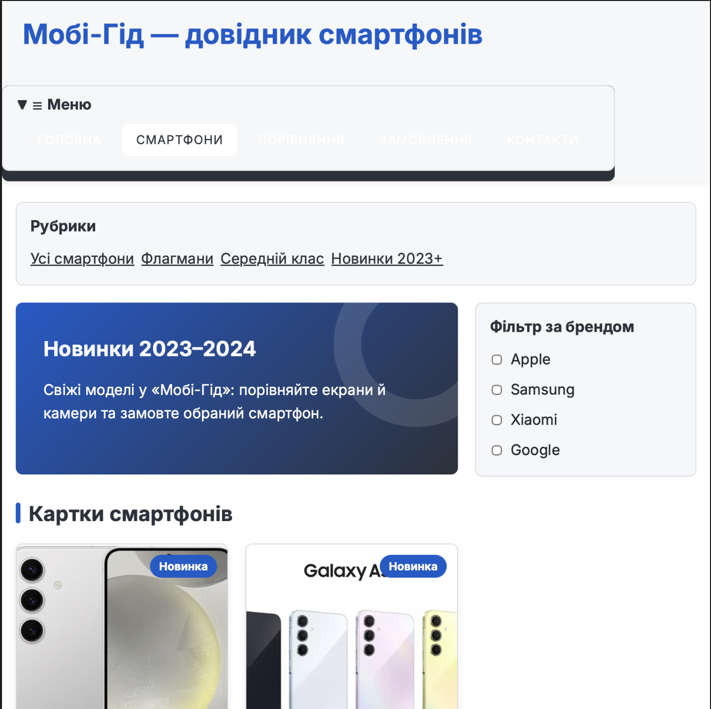
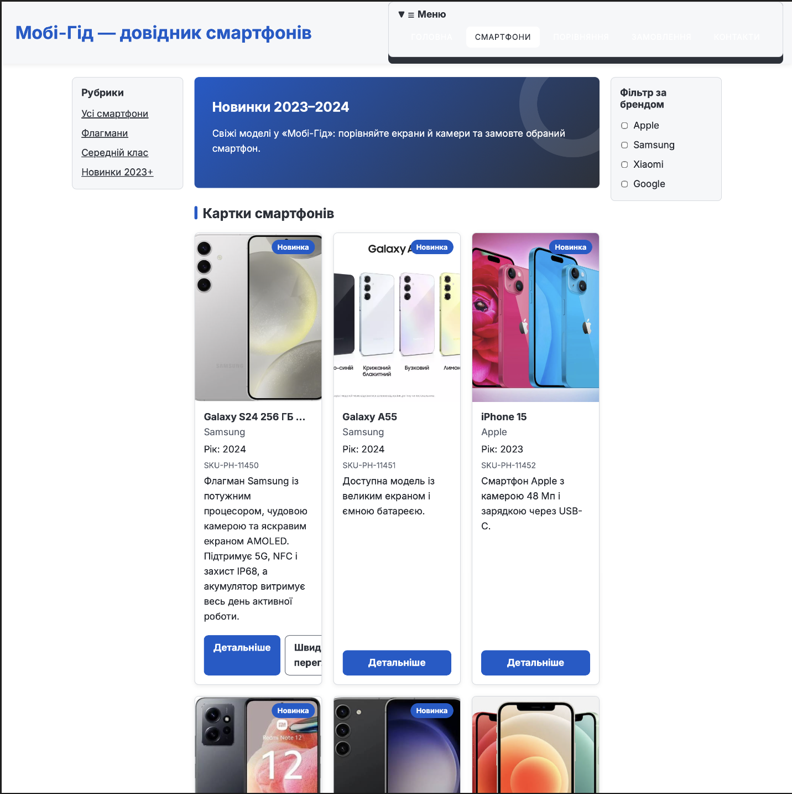

## Перевірка валідатором W3C

| Сторінка | Errors до | Errors після | Що виправлено |
|---|---|---|---|
| index.html | 3 | 0 | склеєні два документи: прибрано зайві </body></html>, повернено відкривальний <header> |
| catalog.html | 0 | 0 | — |
| form.html | 0 | 0 | ... |

## Чому клієнтської валідації недостатньо

У DevTools я відкрив панель Elements, видалив у полі атрибут `required` і відправив порожню форму, після чого вона пройшла без жодної помилки. Це показує, що будь-яку перевірку в браузері користувач може вимкнути або обійти, змінивши код сторінки чи надіславши запит напряму. Тому дані з форми не можна вважати перевіреними тільки тому, що браузер їх пропустив. Насправді перевіряти дані зобов'язаний сервер, а валідація в HTML лише зручність для користувача, бо швидко підказує помилки.

## Оформлення

Сайт використовує одну гарнітуру Inter з Google Fonts (https://fonts.google.com/specimen/Inter), підключену через @import з підтримкою кирилиці; накреслення 400 і 700. Запасний стек: system-ui, Segoe UI, Arial, sans-serif.

Змінні палітри: --color-brand — графітовий колір меню і заголовків, --color-accent — синій акцент (посилання, кнопки, активні стани), --color-bg — білий фон сторінки, --color-surface — світлий фон шапки, футера, зебри та блоків, --color-text — основний колір тексту, --color-muted — другорядний текст. Додатково: --color-on-brand, --color-border, --color-pill-bg, кольори станів valid та invalid, а також --radius, --radius-pill, --space, --shadow, --max-text, --max-page.

Найскладнішим виявився селектор input:focus:invalid, бо треба було зрозуміти, чому без :focus уся форма червоніє одразу після завантаження. Також непросто було розібратися з порядком LVHFA і зі специфічністю в меню: правила a:link і nav a:link мають різну специфічність, тому порядок у файлі і вкладеність селектора треба враховувати разом.

## ЛР5. Блокова модель і позиціонування

### Позиціонування
Шапка сайту (.site-header) має position: sticky з top: 0 і z-index: 100, тому меню лишається вгорі під час прокручування. Картка (.card) і банер (.banner) мають position: relative, щоб абсолютно позиціоновані бейдж «Новинка» (top і right по 0.75rem) та декоративне коло банера (::after) відраховувались від кутів саме цих блоків, а не сторінки.

### Переповнення та зображення
overflow: hidden у картці обрізає фото по заокруглених кутах, а в банері обрізає частину кола, що виступає за межі. Довга назва моделі в h3 має white-space: nowrap, overflow: hidden і text-overflow: ellipsis, повна назва доступна в атрибуті title. Фото має aspect-ratio 3 / 4 і object-fit: cover, тому будь-яке зображення заповнює вертикальну область без викривлення пропорцій.

### Змінні, градієнт і схлопування відступів
Ширина картки задана змінною --card-width в :root, а кольори градієнта банера змінними --color-banner-from та --color-banner-to у linear-gradient(135deg, ...). У демонстрації два сусідні блоки мають margin-bottom 2rem і margin-top 1rem. У звичайному потоці вертикальні відступи схлопуються, тому відстань між ними 2rem (береться більший). У flex-контейнері з flex-direction: column відступи не схлопуються, тому відстань 3rem.

## ЛР6. Макет сторінки: Grid і Flexbox

### Адаптивна сітка
Каталог описано контейнером .cards з display: grid і grid-template-columns: repeat(auto-fit, minmax(var(--min-col), 1fr)), проміжки задає var(--gap). Під час плавної зміни ширини вікна сітка перебудовується з чотирьох колонок у три приблизно на 1410 px, з трьох у дві приблизно на 1170 px і з двох в одну приблизно на 930 px. Браузер сам ділить доступну ширину області каталогу на колонки не вужчі за --min-col (220px) з урахуванням проміжків --gap: скільки колонок поміщається, стільки й створює, а 1fr розтягує їх на весь ряд. Тому медіазапити не потрібні: кількість колонок випливає з арифметики min-col, gap і ширини контейнера. З auto-fill дві картки займали б лише дві вузькі колонки, а решта порожніх колонок лишалася б порожньою, а з auto-fit порожні колонки згортаються і дві картки розтягуються на весь ряд.

### Areas
Макет сторінки описано через grid-template-areas із зонами nav, main, side і foot, кожному блоку задано grid-area. Коли я поміняв місцями слова nav і side у схемі, колонки помінялися місцями без жодної правки HTML. Це доводить, що порядок розмітки описує зміст документа, а розташування блоків на екрані повністю визначає CSS.

### Sticky і Grid
Липкий елемент може рухатися лише в межах свого контейнера. Якщо занести header усередину .layout, його грід-областю стане один короткий рядок сітки, у якому нікуди їздити, тому шапка перестає прилипати. Через це header лишається за межами .layout, у body, а сітка описує тільки зони nav, main, side і foot. Шапка залишається липкою на всіх сторінках.

### dialog
Модальне вікно на <dialog id="details"> відкривається кнопкою «Швидкий перегляд» у першій картці й закривається кнопкою всередині та клавішею Esc. Поки вікно відкрите, сторінка позаду не прокручується (це забезпечує правило body:has(dialog[open]) { overflow: hidden }). Затемнення тла я не створював окремим елементом, його малює псевдоелемент dialog::backdrop.

### Скріншот сітки

### Перевірка валідатором W3C
| Сторінка | Errors до | Errors після |
|---|---|---|
| index.html | 0 | 0 |
| catalog.html | 0 | 0 |
| form.html | 0 | 0 |

## ЛР7. Адаптивний макет і анімації

## Три розкладки

### Телефон (360px)

Одна колонка: меню складене в кнопку «☰ Меню», зверху рубрики каталогу, далі одна картка в ряд, потім фільтр за брендом і футер.

### Планшет (820px)

Дві колонки: каталог і фільтр за брендом поруч, рубрики горизонтальним рядом над ними, меню розгорнуте, дві картки в ряд, шапка липка.

### Десктоп (1440px)

Три колонки: рубрики ліворуч, фільтр за брендом праворуч, три картки в ряд, ширина макета обмежена 1200px і відцентрована.

## Меню без JS
Меню зроблено на елементах details і summary: вони семантичні, працюють із клавіатури (Tab, Enter, Space) і самі повідомляють екранним читалкам, розгорнуте меню чи згорнуте. Чекбокс-трюк з :checked потребує прихованого input і label та ламає семантику, а тут браузер усе робить сам. Коли в темі 9 ми зробимо меню на JavaScript, воно зможе закриватися після вибору пункту, по Esc і по кліку поза меню та оновлювати атрибут aria-expanded.

## Що анімуємо
Анімуються лише transform, opacity, box-shadow і кольори. Конвеєр браузера має етапи Layout, Paint, Composite. Властивість top змінює геометрію, тому на кожному кадрі браузер перераховує розкладку й перемальовує елемент. Властивість transform: translateY(-6px) виконується на останньому етапі Composite, коли браузер просто пересуває вже намальований шар, тому це набагато дешевше й плавніше.

## Reduced motion
Рух на екрані шкодить людям із вестибулярними порушеннями, мігренню та розладами уваги: він може викликати запаморочення, нудоту й втому. Блок prefers-reduced-motion: reduce не вимикає анімації, а робить їх миттєвими (тривалість 0.01ms, один цикл), тому події й кінцеві стани лишаються правильними. Тонше правило для картки замінює підйом на зміну кольору фону, тож відгук на наведення зберігається. Тут !important виправданий, бо одне загальне правило мусить перебити будь-яку специфічність стилів усіх компонентів без переліку селекторів, а налаштування користувача важливіше за авторські стилі.

## Перевірка валідатором W3C
| Сторінка | Errors до | Errors після |
|---|---|---|
| index.html | 0 | 0 |
| catalog.html | 0 | 0 |
| form.html | 0 | 0 |
